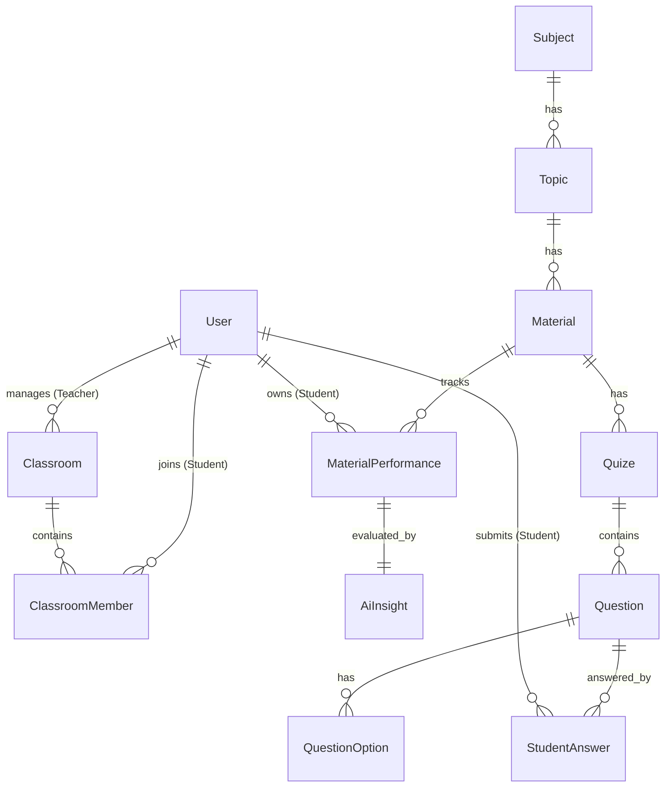

<p align="center">
  <a href="#" target="_blank">
    
  </a>
</p>

<p align="center">
  
  
  
  
  
</p>

---

# 📑 SmartEdu - Platform E-Learning Berbasis AI & Analisis Kinerja

**SmartEdu** adalah platform *e-learning* modern berbasis kecerdasan buatan (AI) yang dirancang untuk merampingkan alur belajar-mengajar dan mempersonalisasikan bimbingan akademik. Menggunakan integrasi data riwayat kuis siswa secara *real-time*, SmartEdu memetakan tingkat pemahaman materi (*Mastery Level*) masing-masing siswa dan secara dinamis menyajikan saran serta analisis personal yang dipandu oleh asisten AI.

Platform ini dibangun dengan arsitektur modern berkinerja tinggi menggunakan **Laravel 12 (Backend)**, **Inertia.js v2 (Bridge)**, dan **React 18 (Frontend)**, serta dipercantik dengan polesan UI elegan dari **Shadcn UI**, **Tailwind CSS**, dan micro-animation interaktif dari **Framer Motion**.

---

## 🚀 Fitur Utama

### 🛡️ 1. Otorisasi Multi-Role (Teacher & Student)
Sistem memiliki pengenalan peran otomatis berbasis middleware (`role:teacher` dan `role:student`) pada alur registrasi dan login:
- **Pendaftaran Default**: Pengguna baru yang mendaftar melalui halaman registrasi publik secara bawaan akan memiliki peran **Siswa (Student)**.
- **Akses Terproteksi**: Pembatasan ketat rute berdasarkan middleware peran masing-masing demi keamanan data akademik kelas.

### 👨‍🏫 2. Portal Guru (Teacher Workspace)
Ruang kerja terpadu bagi pendidik untuk mengelola kurikulum dan mengevaluasi capaian belajar siswa:
- **Dashboard Guru**: Tinjauan cepat statistik pengajaran, jumlah kelas, subjek, dan perkembangan kuis aktif.
- **Manajemen Kelas (Classrooms)**: Membuat kelas baru, mendaftarkan siswa, serta melacak daftar anggota kelas yang berpartisipasi.
- **Manajemen Subjek & Materi**:
  - Menyusun mata pelajaran utama (**Subjects**).
  - Membuat topik pembahasan spesifik (**Topics**) di dalam subjek tersebut.
  - Mempublikasikan materi bacaan dan materi ajar (**Materials**).
- **Desain Evaluasi Kuis (Quizzes)**: Merancang kuis pilihan ganda yang komprehensif lengkap dengan manajemen bank soal (**Questions**) dan opsi jawaban (**Question Options**).

### 👨‍🎓 3. Portal Siswa (Student Learning Center)
Pusat pembelajaran mandiri yang cerdas untuk mengasah pemahaman siswa secara terarah:
- **Dashboard Siswa**: Panel utama yang menyajikan ringkasan kelas yang diikuti, daftar tugas/kuis, serta grafik kemajuan belajar.
- **Pembelajaran Interaktif**: Membaca materi ajar secara dinamis sesuai topik yang ditugaskan oleh guru.
- **Pengerjaan Kuis Real-Time**: Mengerjakan kuis interaktif yang secara otomatis menyimpan jawaban siswa (`StudentAnswer`) dan memvalidasi skor.
- **Evaluasi Kinerja & Mastery Level**:
  Sistem secara dinamis menghitung persentase akurasi belajar siswa berdasarkan akumulasi kuis dan mengategorikan tingkat pemahaman menjadi 3 level:
  - 🔴 **Weak (Lemah)**
  - 🟡 **Medium (Sedang)**
  - 🟢 **Strong (Kuat)**
- **Chatbot AI & AI Insights**:
  Siswa memiliki akses ke asisten AI personal. Berdasarkan riwayat data evaluasi performa belajar (`material_performances`), kecerdasan buatan menyusun analisis mendalam (`analysis_text`) serta langkah strategis rekomendasi peningkatan belajar (`recommendation_text`) yang disimpan rapi di tabel `ai_insights`.

---

## 🛠️ Stack Teknologi & Ekosistem

SmartEdu dikembangkan dengan kombinasi teknologi terbaik untuk memastikan kecepatan, keamanan, dan keindahan antarmuka:

| Kategori | Teknologi | Deskripsi |
| :--- | :--- | :--- |
| **Inti Backend** | **PHP v8.3 / v8.2** | Runtime bahasa utama untuk efisiensi logika server. |
| **Framework Utama** | **Laravel v12.0** | Versi terbaru dengan struktur ramping, database migration canggih, dan ORM cepat. |
| **Bridging SPA** | **Inertia.js v2.0** | Adapter frontend-backend instan untuk pengalaman Single Page Application tanpa REST API manual. |
| **Perpustakaan UI** | **React v18.2** | Library JavaScript deklaratif untuk reaktivitas komponen yang andal. |
| **Build Tool** | **Vite v7.0** | Tool bundling super cepat untuk kompilasi modul JS/CSS instan di masa pengembangan. |
| **Engine Styling** | **Tailwind CSS v3** | Framework CSS utility-first untuk kustomisasi antarmuka premium dan responsif. |
| **Desain Antarmuka** | **Shadcn UI / Radix** | Fondasi komponen UI solid yang aksesibel dan memiliki visual konsisten. |
| **Animasi Mikro** | **Framer Motion v12** | Engine animasi premium untuk menghasilkan transisi halaman dan interaksi tombol yang hidup. |
| **Notifikasi** | **Sonner** | Library toaster premium dengan feedback responsif nan estetis. |

---

## 📊 Arsitektur Database & Relasi Model (Eloquent)

Struktur tabel SmartEdu dirancang secara ternormalisasi dengan integritas referensial yang kuat guna mengelola siklus belajar dari kurikulum hingga evaluasi AI:



### Penjelasan Utama Model:
*   **User**: Menampung kredensial login dengan kolom `role` bernilai `teacher` atau `student`.
*   **Classroom & ClassroomMember**: Menghubungkan Guru selaku pembuat kelas, dan Siswa selaku peserta didik melalui tabel pivot *classroom_members* dengan atribut waktu `joined_at`.
*   **Subject, Topic, & Material**: Struktur kurikulum 3 tingkat (Mata Pelajaran ➔ Topik Bahasan ➔ Konten/Materi Belajar).
*   **Quize, Question, & QuestionOption**: Struktur kuis terintegrasi di mana satu Materi Belajar dapat diasosiasikan dengan instansi kuis berisikan bank soal pilihan ganda.
*   **StudentAnswer**: Merekam opsi jawaban yang dipilih siswa untuk setiap butir soal guna dihitung ketepatannya secara otomatis.
*   **MaterialPerformance**: Menyimpan data kumulatif hasil pengerjaan kuis siswa (jumlah pertanyaan, jumlah jawaban benar, persentase akurasi, dan status `mastery_level`).
*   **AiInsight**: Menyimpan rangkuman evaluasi kognitif (`analysis_text`) serta saran pembelajaran taktis (`recommendation_text`) berbasis AI yang terhubung secara 1-to-1 dengan performa materi siswa.

---

## 📂 Struktur Folder Proyek

```bash
smartEdu/
├── app/
│   ├── Http/
│   │   ├── Controllers/
│   │   │   ├── Auth/              # Logika masuk, daftar, & reset sandi (Laravel Breeze)
│   │   │   ├── Guru/              # Kontroler operasional untuk Guru (Dashboard, Kelas, Materi, Kuis)
│   │   │   └── Siswa/             # Kontroler pembelajaran untuk Siswa (Dashboard, Materi, Jawaban, AI)
│   │   └── Middleware/            # Validasi otorisasi peran (Role Verification)
│   └── Models/                    # Hubungan relasional Eloquent (User, Subject, Material, dll.)
├── bootstrap/                     # Pendaftaran middleware & routing terpadu (app.php)
├── config/                        # Berkas konfigurasi inti Laravel (App, Database, Session)
├── database/
│   ├── migrations/                # Schema DDL tabel SmartEdu
│   └── seeders/                   # Seeder inisialisasi awal (Pengguna Dummy & Subjek)
├── resources/
│   ├── css/
│   │   └── app.css                # Konfigurasi CSS Tailwind global
│   └── js/
│       ├── Components/            # Koleksi elemen antarmuka reusable (Shadcn, dsb.)
│       ├── constats/              # Catatan: Direktori navigasi sidebar (konvensi proyek 'constats')
│       ├── hooks/                 # Custom React Hooks
│       ├── layout/                # Template bingkai aplikasi (DashboardLayout & Sidebar)
│       └── Pages/                 # Komponen halaman utama (Auth, Siswa, Guru, Welcome)
├── routes/
│   ├── auth.php                   # Rute keamanan autentikasi
│   └── web.php                    # Gerbang rute utama berbasis grup middleware
└── package.json                   # Daftar dependensi JS & instruksi kompilasi Vite
```

---

## ⚙️ Panduan Instalasi Lokal & Pengembangan

Ikuti langkah-langkah sistematis di bawah ini untuk memasang dan menjalankan proyek di server lokal Anda:

### 📋 Prasyarat Sistem
Pastikan komputer Anda telah terinstal:
*   PHP >= 8.2 atau 8.3
*   Composer
*   Node.js (versi LTS direkomendasikan) & NPM

### 1. Kloning Repositori
```bash
git clone <repository-url>
cd smartEdu
```

### 2. Pasang Dependensi Backend & Frontend
```bash
# Memasang dependensi PHP
composer install

# Memasang dependensi Javascript & Tailwind
npm install
```

### 3. Konfigurasi Environment File
Salin konfigurasi default `.env.example` ke `.env` dan jalankan pembuat kunci keamanan Laravel:
```bash
copy .env.example .env
php artisan key:generate
```
*Sesuaikan koneksi database di file `.env` Anda (Proyek ini secara bawaan siap menggunakan database **SQLite** atau dapat Anda ubah ke **MySQL** sesuai kebutuhan).*

### 4. Migrasi Skema & Seeding Data Utama
Inisialisasi tabel database dan masukkan data dummy awal dengan satu perintah:
```bash
php artisan migrate --seed
```
Proses *seeding* akan secara otomatis mendaftarkan **2 Akun Dummy** untuk pengujian aplikasi:

| Peran | Alamat Email | Kata Sandi |
| :--- | :--- | :--- |
| **👨‍🏫 Guru (Teacher)** | `guru@gmail.com` | `password` |
| **👨‍🎓 Siswa (Student)** | `siswa@gmail.com` | `password` |

### 5. Menjalankan Server Pengembangan (Dev Server)
SmartEdu dilengkapi skrip kustom terintegrasi menggunakan `concurrently`. Anda cukup menjalankan satu perintah berikut untuk menghidupkan Laravel server, Vite compiler, queue worker, dan log stream secara simultan:
```bash
composer run dev
```

Atau jika Anda ingin menjalankan layanannya satu per satu secara manual pada terminal terpisah:
```bash
# Terminal 1: Menjalankan Server Laravel
php artisan serve

# Terminal 2: Menjalankan Server Aset Vite
npm run dev

# Terminal 3: Menjalankan Listener Antrean (Penting untuk pemrosesan AI secara asinkron)
php artisan queue:listen
```

Setelah server aktif, buka peramban dan kunjungi **[http://127.0.0.1:8000](http://127.0.0.1:8000)**.

---

## 🧪 Pengujian Unit & Fitur (Testing Suite)

Menjamin keandalan alur otorisasi dan logika kuis menggunakan **PHPUnit**:

*   **Menjalankan Seluruh Pengujian**:
    ```bash
    php artisan test --compact
    ```
*   **Menjalankan Pengujian di Berkas Tertentu**:
    ```bash
    php artisan test --compact tests/Feature/ExampleTest.php
    ```

---

## 🎨 Standarisasi Penulisan Kode (Code Formatting)

Guna menyamakan standar penulisan kode kolaboratif, jalankan alat pemformatan ini sebelum mengunggah pekerjaan Anda ke repositori:

*   **Format Kode PHP Backend (Laravel Pint)**:
    ```bash
    vendor/bin/pint
    ```
*   **Format Kode JS/React Frontend (Prettier)**:
    ```bash
    npm run format
    ```

---

> [!TIP]
> **Catatan Arsitektur**:
> *   Direktori navigasi diletakkan di dalam folder `resources/js/constats` (menggunakan nama *constats* sesuai konvensi awal repositori). Pastikan deklarasi *import* Anda merujuk ke `@/constats/navigation`.
> *   Selalu manfaatkan helper `@inertiajs/react` seperti `<Link>` atau `router.visit()` untuk melakukan navigasi halaman agar siklus Single Page Application (SPA) tidak terputus.

> [!IMPORTANT]
> **Optimasi Inertia v2**:
> Demi menyajikan antarmuka premium berkinerja tinggi, manfaatkan fitur **Deferred Props** dan **WhenVisible** pada halaman materi yang memiliki teks panjang. Tampilkan komponen *pulsing skeleton* yang indah sebagai *fallback* pemuatan data asinkron agar memberikan impresi visual premium bagi pengguna.
