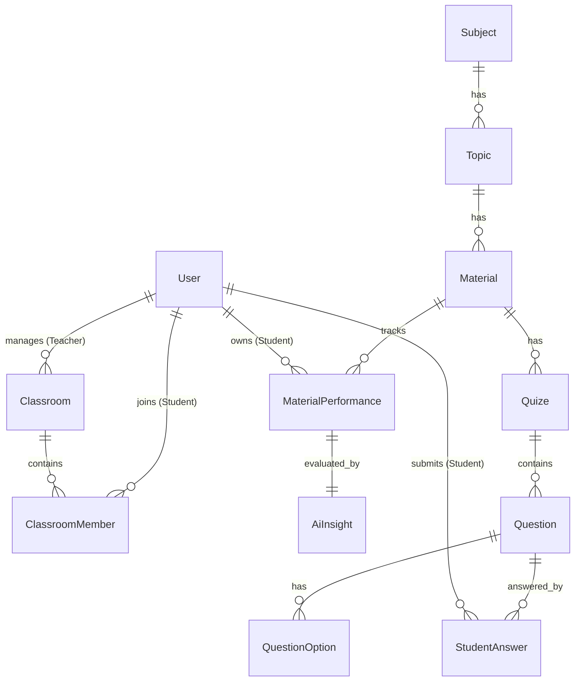

# 🎓 SmartEdu – AI-Powered E-Learning Platform & Learning Performance Analytics

**SmartEdu** is a modern AI-powered e-learning platform designed to streamline teaching and learning activities while providing personalized academic guidance. By leveraging students' quiz history and learning performance data, SmartEdu evaluates individual subject mastery levels and dynamically generates personalized learning recommendations through an integrated AI assistant.

The platform is built using a modern web architecture powered by **Laravel 12 (Backend)**, **Inertia.js v2 (Frontend-Backend Bridge)**, and **React 18 (Frontend)**. The user interface is enhanced with **Shadcn UI**, **Tailwind CSS**, and interactive micro-animations powered by **Framer Motion**.

---

## 🚀 Key Features

### 🛡️ 1. Multi-Role Authentication & Authorization (Teacher & Student)

The system implements role-based access control through dedicated middleware (`role:teacher` and `role:student`) across authentication and application workflows.

- **Default Registration:** New users registering through the public registration page are automatically assigned the **Student** role.
- **Protected Access:** Application routes are restricted based on user roles to ensure proper authorization and protect classroom and academic data.

### 👨‍🏫 2. Teacher Portal (Teacher Workspace)

A centralized workspace that enables teachers to manage learning materials, organize classrooms, and evaluate student performance.

- **Teacher Dashboard:** Provides an overview of teaching statistics, including the number of classrooms, subjects, and active quizzes.
- **Classroom Management:** Create classrooms, enroll students, and monitor classroom membership and participation.
- **Subject & Learning Material Management:**
  - Create and manage academic subjects (**Subjects**).
  - Organize learning content into specific discussion topics (**Topics**).
  - Publish reading materials and educational resources (**Materials**).
- **Quiz Management:** Create comprehensive multiple-choice quizzes with question banks (**Questions**) and answer choices (**Question Options**).

### 👨‍🎓 3. Student Portal (Student Learning Center)

A self-paced learning environment that helps students improve their understanding through structured learning activities and performance evaluation.

- **Student Dashboard:** Displays enrolled classrooms, assigned quizzes, and visual learning progress summaries.
- **Interactive Learning:** Access and study educational materials dynamically based on topics provided by teachers.
- **Real-Time Quiz Submission:** Complete interactive quizzes with automatically recorded student responses (`StudentAnswer`) and score validation.
- **Learning Performance & Mastery Level:**

  The system dynamically calculates students' learning accuracy based on accumulated quiz results and categorizes their understanding into three mastery levels:

  - 🔴 **Weak:** Indicates insufficient understanding of the learning material.
  - 🟡 **Medium:** Indicates a moderate level of understanding.
  - 🟢 **Strong:** Indicates a strong understanding of the learning material.

- **AI Chatbot & Personalized AI Insights:**

  Students can interact with a personalized AI assistant. By analyzing historical learning performance data stored in `material_performances`, the AI generates:

  - **Performance Analysis (`analysis_text`):** An evaluation of the student's learning progress and areas requiring improvement.
  - **Learning Recommendations (`recommendation_text`):** Actionable suggestions and learning strategies to improve academic performance.

  Generated insights are stored in the `ai_insights` table for future reference.

---

## 🛠️ Technology Stack & Ecosystem

SmartEdu combines modern technologies to deliver a maintainable backend, responsive user interface, and interactive learning experience.

| Category | Technology | Description |
| :--- | :--- | :--- |
| **Backend Language** | PHP 8.3 / 8.2 | Primary programming language for server-side application logic. |
| **Backend Framework** | Laravel 12 | PHP framework for application architecture, database migrations, and ORM operations. |
| **SPA Integration** | Inertia.js v2 | Connects Laravel and React to deliver SPA-like navigation without requiring a manually maintained REST API. |
| **Frontend Library** | React 18.2 | Component-based JavaScript library for building interactive user interfaces. |
| **Build Tool** | Vite 7 | Modern frontend build tool for fast development and asset compilation. |
| **CSS Framework** | Tailwind CSS v3 | Utility-first CSS framework for building responsive and customizable interfaces. |
| **UI Components** | Shadcn UI / Radix UI | Accessible and reusable UI components with consistent design patterns. |
| **Animation Library** | Framer Motion v12 | Animation library for interactive transitions and micro-interactions. |
| **Notifications** | Sonner | Toast notification library for providing user feedback. |

---

## 📊 Database Architecture & Eloquent Model Relationships

SmartEdu uses a relational database structure designed to maintain data consistency and referential integrity across the learning management and AI evaluation workflows.

### Entity Relationship Diagram (ERD)



### Key Model Descriptions

- **User:** Stores user authentication credentials and role information. The `role` column determines whether a user is a `teacher` or `student`.
- **Classroom & ClassroomMember:** Connects teachers who manage classrooms with students who enroll in them. The `classroom_members` pivot table stores membership information, including the `joined_at` timestamp.
- **Subject, Topic & Material:** Represents the three-level learning content hierarchy: Subject → Topic → Learning Material.
- **Quiz, Question & QuestionOption:** Manages the assessment structure, where each quiz contains multiple questions, and each question can have multiple answer options.
- **StudentAnswer:** Records students' selected answers for individual quiz questions, enabling automated answer validation and score calculation.
- **MaterialPerformance:** Stores aggregated student performance data, including the total number of questions, correct answers, accuracy percentage, and `mastery_level`.
- **AiInsight:** Stores AI-generated learning evaluations (`analysis_text`) and actionable learning recommendations (`recommendation_text`). Each insight is associated with a specific student material performance record through a one-to-one relationship.

---

## 📂 Project Structure

The following structure highlights the main directories and components of the SmartEdu application.

```bash
smartEdu/
├── app/
│   ├── Http/
│   │   ├── Controllers/
│   │   │   ├── Auth/              # Authentication and password management
│   │   │   ├── Guru/              # Teacher operations (Dashboard, Classrooms, Materials, Quizzes)
│   │   │   └── Siswa/             # Student operations (Dashboard, Learning, Answers, AI)
│   │   └── Middleware/            # Role-based access control
│   └── Models/                    # Eloquent models and relationships
├── bootstrap/                     # Application bootstrap and middleware registration
├── config/                        # Application configuration files
├── database/
│   ├── migrations/                # Database schema definitions
│   └── seeders/                   # Initial dummy users and subject data
├── resources/
│   ├── css/
│   │   └── app.css                # Global Tailwind CSS configuration
│   └── js/
│       ├── Components/            # Reusable UI components (Shadcn UI, etc.)
│       ├── constats/              # Sidebar navigation configuration
│       ├── hooks/                 # Custom React hooks
│       ├── layout/                # Application layouts (DashboardLayout, Sidebar)
│       └── Pages/                 # Main application pages (Auth, Student, Teacher, Welcome)
├── routes/
│   ├── auth.php                   # Authentication routes
│   └── web.php                    # Main application routes and middleware groups
└── package.json                   # Frontend dependencies and Vite scripts
```

---

## ⚙️ Local Installation & Development Guide

Follow these steps to configure and run SmartEdu in your local development environment.

### 📋 System Requirements

Make sure the following tools are installed on your machine:

- PHP >= 8.2 (PHP 8.3 recommended)
- Composer
- Node.js (LTS version recommended)
- NPM

### 1. Clone the Repository

```bash
git clone <repository-url>
cd smartEdu
```

### 2. Install Backend & Frontend Dependencies

Install the required PHP and JavaScript dependencies.

```bash
# Install PHP dependencies
composer install

# Install JavaScript and frontend dependencies
npm install
```

### 3. Configure Environment Variables

Copy the example environment file and generate a new Laravel application key.

```bash
# Windows
copy .env.example .env

# Generate application key
php artisan key:generate
```

Configure your database connection in the `.env` file.

By default, the project can be configured to use **SQLite** or **MySQL**, depending on your development environment.

### 4. Run Database Migrations & Seeders

Initialize the database schema and populate the database with initial dummy data.

```bash
php artisan migrate --seed
```

The seeder automatically creates two dummy accounts for application testing:

| Role | Email Address | Password |
| :--- | :--- | :--- |
| **👨‍🏫 Teacher** | `guru@gmail.com` | `password` |
| **👨‍🎓 Student** | `siswa@gmail.com` | `password` |

### 5. Start the Development Server

SmartEdu includes an integrated development script using `concurrently`. You can start the Laravel server, Vite development server, queue worker, and log stream simultaneously with a single command.

```bash
composer run dev
```

Alternatively, you can start each service manually in separate terminal windows.

```bash
# Terminal 1: Start Laravel development server
php artisan serve

# Terminal 2: Start Vite development server
npm run dev

# Terminal 3: Start the queue listener
php artisan queue:listen
```

The queue listener is important for processing asynchronous jobs, including AI-related tasks.

Once the development server is running, open your browser and navigate to:

**http://127.0.0.1:8000**

---

## 🧪 Unit & Feature Testing

SmartEdu uses **PHPUnit** to verify application functionality, authentication workflows, role-based authorization, and quiz-related business logic.

**Run the complete test suite:**

```bash
php artisan test --compact
```

**Run tests from a specific file:**

```bash
php artisan test --compact tests/Feature/ExampleTest.php
```

---

## 🎨 Code Formatting & Standards

To maintain consistent code quality and formatting across the project, run the following tools before committing your changes.

**PHP Backend Formatting (Laravel Pint):**

```bash
vendor/bin/pint
```

**JavaScript / React Frontend Formatting (Prettier):**

```bash
npm run format
```

---

## 💡 Development Notes

> **Architecture & Navigation**
>
> - The sidebar navigation configuration is located in `resources/js/constats`. The directory intentionally retains the original project naming convention.
> - Make sure imports reference the correct path, for example: `@/constats/navigation`.
> - Use Inertia.js navigation helpers such as `<Link>` and `router.visit()` from `@inertiajs/react` to maintain SPA-like navigation without triggering unnecessary full-page reloads.

> **Inertia.js v2 Performance Optimization**
>
> - Leverage **Deferred Props** to load non-critical page data asynchronously.
> - Use **WhenVisible** to fetch data when specific page sections enter the viewport.
> - Implement animated skeleton loading components as fallback UI while asynchronous data is being retrieved.
>
> These techniques help improve perceived loading performance and create a smoother user experience, particularly on pages containing extensive learning materials.

---

**SmartEdu** – Making learning more personalized through AI-powered insights and performance analytics.
